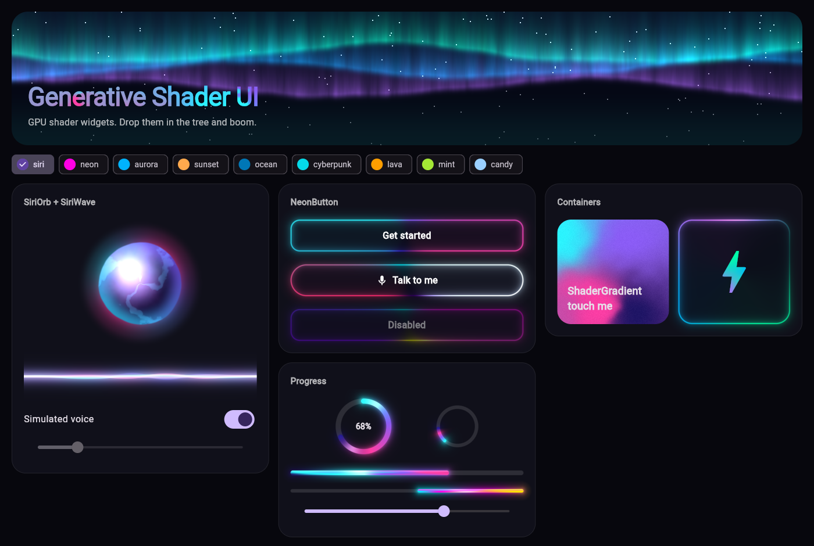
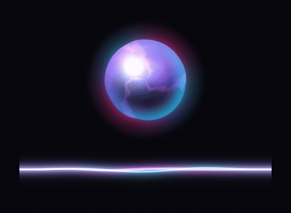
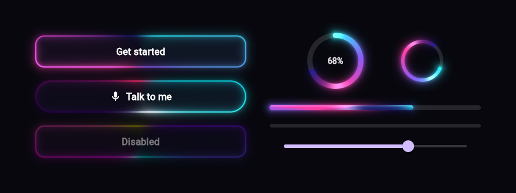
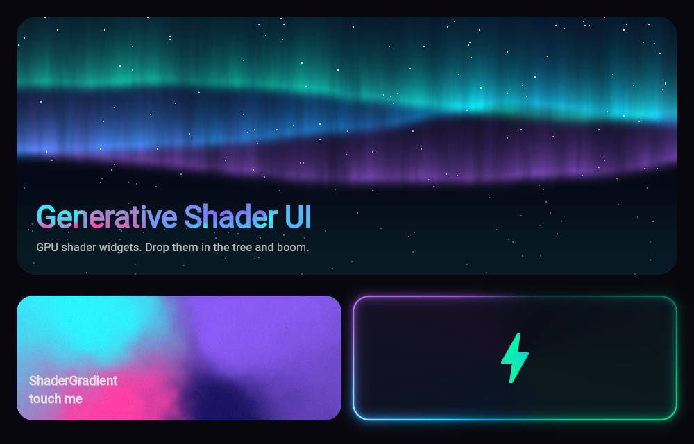

# generative_shader_ui

[](https://pub.dev/packages/generative_shader_ui)
[](https://pub.dev/packages/generative_shader_ui/score)
[](https://pub.dev/packages/generative_shader_ui)
[](LICENSE)

**Drop-in GPU shader widgets for Flutter.** Siri-style fluid orbs and voice
waves, glowing neon buttons, living mesh gradients, aurora backgrounds and
shader-powered progress indicators.

Add a widget to the tree and *boom* — it animates. No GLSL, no setup, no
controllers. Everything is customized through plain Dart properties.



| Audio-reactive Siri orb + waves | Neon buttons & progress |
| :---: | :---: |
|  |  |



## Features

- **Zero config** – every widget has beautiful defaults and starts animating
  the moment it is mounted.
- **GPU rendered** – real fragment shaders (`FragmentProgram`), one draw call
  per widget, repainting without rebuilding the widget tree.
- **Audio reactive** – pass a 0..1 microphone level to `SiriOrb` /
  `SiriWave`; raw, jittery meter values are smoothed for you.
- **Touch & hover reactive** – gradients bend, neon lights follow the finger,
  orbs pulse on tap.
- **Themeable** – one `ShaderPalette` (4 colors) styles everything; 9 presets
  included. Changing palettes cross-fades smoothly.
- **Accessible** – buttons support keyboard activation, focus and screen
  readers; progress indicators expose their value; platform *reduce motion* is
  honored automatically.
- **Battery friendly** – tickers pause when animation is off, when the widget
  is offstage (`TickerMode`) and once transitions settle.
- **All platforms** – Android, iOS, web (CanvasKit & Skwasm/WASM), Windows,
  macOS and Linux, Skia or Impeller. A gradient fallback is painted while
  shaders load.

## Widgets

| Widget | What it is |
| --- | --- |
| `SiriOrb` | Fluid, glowing assistant orb. Breathes when idle, dances with `amplitude`. |
| `SiriWave` | Four layered, glowing voice waves. |
| `NeonButton` | Button with animated neon border, glow, hover/press/focus states. |
| `NeonContainer` | Wrap *any* widget in a neon border with glassy fill. |
| `ShaderGradient` | Container filled with a living mesh gradient (touch reactive). |
| `AuroraBackground` | Northern-lights backdrop with twinkling stars. |
| `ShaderCircularProgressIndicator` | Glowing gradient ring, determinate or indeterminate. |
| `ShaderLinearProgressIndicator` | Liquid neon bar, determinate or indeterminate. |
| `ShaderGradientText` | Text filled with the animated mesh gradient. |
| `ShaderGradientMask` | Fill icons, images or any widget with the gradient. |

## Getting started

```yaml
dependencies:
  generative_shader_ui: ^1.0.0
```

```dart
import 'package:generative_shader_ui/generative_shader_ui.dart';
```

That's it — the shaders are bundled with the package.

## Usage

### Just drop it in

```dart
const SiriOrb()                          // breathing orb
const SiriWave()                         // idle voice waves
const ShaderCircularProgressIndicator()  // indeterminate spinner
const ShaderLinearProgressIndicator()    // indeterminate bar
const ShaderGradientText('Hello')        // animated gradient headline

NeonButton(
  onPressed: () {},
  child: const Text('Get started'),
)
```

### React to a voice

Feed any microphone level (from `record`, `flutter_sound`, `noise_meter`, …):

```dart
SiriOrb(
  size: 240,
  amplitude: micLevel,          // 0.0 – 1.0, smoothing is built in
  palette: ShaderPalette.siri,
)

SiriWave(height: 120, amplitude: micLevel)
```

### Containers & backgrounds

```dart
ShaderGradient(
  palette: ShaderPalette.sunset,
  borderRadius: BorderRadius.circular(24),
  padding: const EdgeInsets.all(24),
  warp: 1.4,      // liquid distortion
  grain: 0.3,     // film grain, prevents banding
  child: const Text('Living gradient'),
)

AuroraBackground(
  child: Center(child: Text('Good evening')),
)

NeonContainer(
  palette: ShaderPalette.cyberpunk,
  borderRadius: 24,
  glow: 18,
  child: const ListTile(title: Text('Neon card')),
)
```

### Progress

```dart
ShaderCircularProgressIndicator(
  value: 0.72,            // null = indeterminate
  size: 96,
  strokeWidth: 9,
  child: const Text('72%'),
)

ShaderLinearProgressIndicator(value: download, minHeight: 8)
```

### Palettes

```dart
ShaderPalette.siri, .neon, .aurora, .sunset, .ocean,
             .cyberpunk, .lava, .mint, .candy

const ShaderPalette(Color(0xFF00E5FF), Color(0xFF7C4DFF),
                    Color(0xFFFF4081), Color(0xFF1A1033));

ShaderPalette.fromColors([Colors.teal, Colors.amber]);
ShaderPalette.monochrome(Colors.deepPurple);
```

Change `palette` on any mounted widget and it smoothly cross-fades.

### Optional: precache shaders

Shaders load lazily (a gradient fallback is shown for the first frame or two).
To have the very first frame GPU-rendered, precache before `runApp`:

```dart
Future<void> main() async {
  WidgetsFlutterBinding.ensureInitialized();
  await ShaderLibrary.precache();
  runApp(const MyApp());
}
```

## Common properties

| Property | Meaning |
| --- | --- |
| `palette` | Four colors that drive the shader. |
| `speed` | Animation speed multiplier (`0` freezes). |
| `animate` | Turn animation off entirely (the ticker stops). |
| `interactive` | Whether touch / hover affects the effect. |
| `glow` | Glow spread; glows paint outside the bounds like a `BoxShadow`. |

## Example

A full gallery lives in [`example/lib/main.dart`](example/lib/main.dart):

```bash
cd example
flutter run -d chrome   # or windows, macos, linux, android, ios
```

## How it works

Each widget owns a `FragmentShader` created from a bundled `.frag` program
and a `Ticker`. Every frame the ticker advances time and smoothed values
(amplitude, progress, highlight, touch, palette cross-fade) and notifies a
`CustomPainter` through its `repaint` listenable, so only the shader layer
repaints — the widget tree is never rebuilt for animation.

## License

MIT © developerashkan
