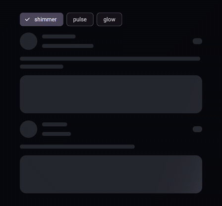
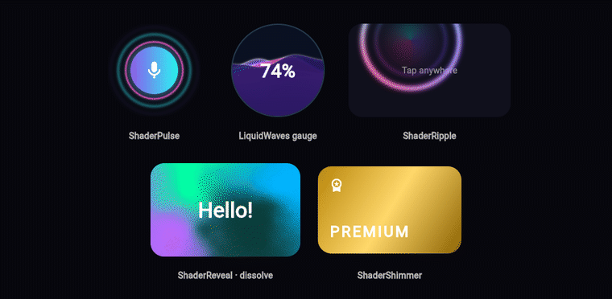
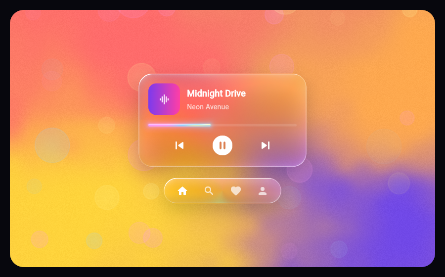
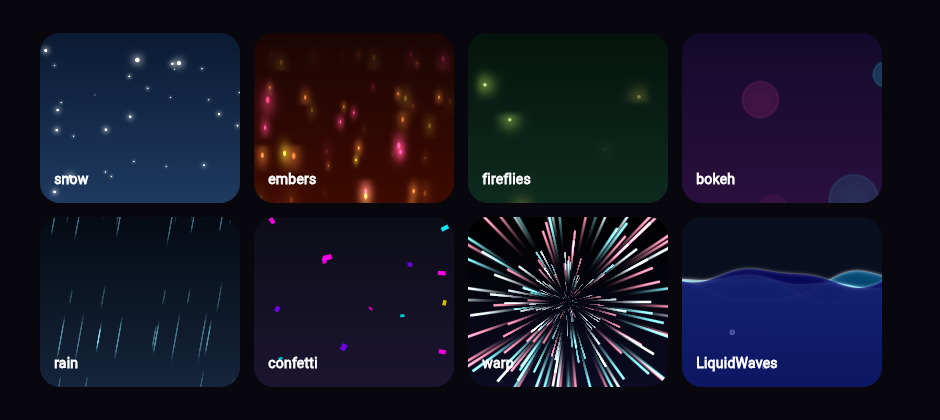

# generative_shader_ui

[](https://pub.dev/packages/generative_shader_ui)
[](https://pub.dev/packages/generative_shader_ui/score)
[](https://pub.dev/packages/generative_shader_ui)
[](LICENSE)

**Drop-in GPU shader widgets for Flutter.** A skeleton loader that builds
itself from your real layout, liquid glass, particle fields, Siri-style orbs
and voice waves, neon buttons, ripples, pulses, liquid gauges and shader
reveal transitions.

Add a widget to the tree and *boom* — it animates. No GLSL, no setup, no
controllers. Everything is customized through plain Dart properties.


| Auto skeleton loader | Motion widgets |
| :---: | :---: |
|  |  |

| Liquid glass | Particles |
| :---: | :---: |
|  |  |

| Audio-reactive Siri orb + waves | Neon buttons & progress |
| :---: | :---: |
|  |  |

## Features

- **Zero config** – every widget has beautiful defaults and starts animating
  the moment it is mounted.
- **Skeletons without placeholder code** – `ShaderSkeleton` walks your real
  widget tree and turns text lines, images, avatars and boxes into
  shimmering bones. Every skeleton on screen shimmers in sync.
- **GPU rendered** – 15 hand-written fragment shaders (`FragmentProgram`), one
  draw call per effect, repainting without rebuilding the widget tree.
  Particles are procedural: thousands of them cost no Dart work per frame.
- **Audio, touch & hover reactive** – orbs and waves follow a microphone
  level; gradients bend, glass highlights, particles and waves follow the
  pointer.
- **Motion** – reveal transitions (dissolve, burn, iris, wipe, pixels,
  liquid) for any widget, `AnimatedSwitcher` and page routes.
- **Themeable** – one `ShaderPalette` (4 colors) styles everything, 11 presets
  included, and `ShaderTheme` sets the palette for a whole subtree. Palette
  changes cross-fade smoothly.
- **Accessible** – buttons support keyboard, focus and screen readers;
  progress indicators expose their value; skeletons announce "Loading" and
  block taps; platform *reduce motion* is honored everywhere.
- **Battery friendly** – tickers stop when idle, offstage or settled;
  `ShaderTheme(maxFps: 30)` caps repaints for decorative effects.
- **All platforms** – Android, iOS, web (CanvasKit & Skwasm/WASM), Windows,
  macOS and Linux, Skia or Impeller. Fallbacks paint while shaders load.

## Widgets

| Widget | What it is |
| --- | --- |
| `ShaderSkeleton` | Skeleton loader generated from the child's layout; `shimmer`, `pulse`, `glow`. |
| `SkeletonBone` / `SkeletonIgnore` | Explicit bone shapes (`.circle`, `.text`) / leave parts out. |
| `LiquidGlass` | Blurred, saturated glass with rim light, specular highlight and iridescent edge. |
| `ParticleField` | Snow, embers, fireflies, bokeh, rain, confetti, warp. Background or overlay. |
| `ShaderReveal` | Dissolve / burn / iris / wipe / pixels / liquid reveal driven by `progress`. |
| `AnimatedShaderReveal` | Implicitly animated reveal (`visible: true/false`). |
| `ShaderRevealRoute` | Page route with a shader transition. |
| `ShaderRipple` | Glowing multi-touch ripples, plus `ShaderRippleController`. |
| `ShaderPulse` | Radar rings for live, listening and attention states. |
| `LiquidWaves` | Layered liquid with foam and bubbles: gauge or hero background. |
| `ShaderShimmer` | Glossy shine sweeping over any widget. |
| `SiriOrb` | Fluid, glowing assistant orb. Breathes when idle, dances with `amplitude`. |
| `SiriWave` | Four layered, glowing voice waves. |
| `NeonButton` | Button with animated neon border, glow, hover/press/focus states. |
| `NeonContainer` | Wrap *any* widget in a neon border with glassy fill. |
| `ShaderGradient` | Container filled with a living mesh gradient (touch reactive). |
| `AuroraBackground` | Northern-lights backdrop with twinkling stars. |
| `ShaderCircularProgressIndicator` | Glowing gradient ring, determinate or indeterminate. |
| `ShaderLinearProgressIndicator` | Liquid neon bar, determinate or indeterminate. |
| `ShaderGradientText` / `ShaderGradientMask` | Text, icons or images filled with the animated gradient. |
| `ShaderTheme` | Palette, speed, animate switch and FPS cap for a subtree. |

## Getting started

```yaml
dependencies:
  generative_shader_ui: ^1.1.0
```

```dart
import 'package:generative_shader_ui/generative_shader_ui.dart';
```

That's it — the shaders are bundled with the package.

## Usage

### Just drop it in

```dart
const SiriOrb()                          // breathing orb
const ParticleField()                    // snowfall backdrop
const LiquidWaves(level: 0.4)            // liquid hero background
const ShaderCircularProgressIndicator()  // indeterminate spinner
const ShaderGradientText('Hello')        // animated gradient headline

NeonButton(onPressed: () {}, child: const Text('Get started'))
```

### Skeleton loading (no placeholder layout)

Build your normal UI — with sample data while loading — and wrap it:

```dart
ShaderSkeleton(
  isLoading: user == null,
  child: ListTile(
    leading: const CircleAvatar(),
    title: Text(user?.name ?? 'Placeholder name'),
    subtitle: Text(user?.email ?? 'placeholder@example.com'),
  ),
)
```

Every line of text becomes a rounded bar, images and colored boxes become
rectangles, avatars become circles. When `isLoading` turns false the bones
cross-fade into the real content.

```dart
ShaderSkeleton(
  isLoading: loading,
  effect: SkeletonEffect.glow,          // shimmer | pulse | glow
  baseColor: Colors.grey.shade300,      // theme-aware by default
  child: Column(children: [
    const SkeletonBone.circle(size: 56),   // explicit shapes
    const SkeletonBone.text(lines: 3),
    SkeletonIgnore(child: decoration),     // never turned into a bone
    realContent,
  ]),
)
```

### Liquid glass

```dart
Stack(children: [
  const ShaderGradient(palette: ShaderPalette.sunset),   // anything colorful
  const ParticleField(style: ParticleStyle.bokeh),
  Center(
    child: LiquidGlass(
      borderRadius: 28,
      blur: 18,
      saturation: 1.6,
      child: const Text('Now playing'),
    ),
  ),
])
```

### Particles

```dart
const ParticleField(style: ParticleStyle.snow)       // fills its parent

ParticleField(
  style: ParticleStyle.confetti,
  foreground: true,          // over the child, never blocks taps
  density: 0.5,
  child: successPage,
)
```

Styles: `snow`, `embers`, `fireflies`, `bokeh`, `rain`, `confetti`, `warp`.

### Reveal transitions

```dart
// Implicit
AnimatedShaderReveal(
  visible: loaded,
  style: RevealStyle.burn,     // dissolve | burn | iris | wipe | pixels | liquid
  child: const ResultCard(),
)

// AnimatedSwitcher
AnimatedSwitcher(
  duration: const Duration(milliseconds: 900),
  transitionBuilder: ShaderReveal.transitionBuilder(style: RevealStyle.dissolve),
  child: Text('$count', key: ValueKey(count)),
)

// Page route
Navigator.of(context).push(
  ShaderRevealRoute(style: RevealStyle.iris, builder: (_) => const Details()),
);

// Or drive it yourself
ShaderReveal(progress: controller.value, child: card)
```

### Feedback & attention

```dart
ShaderRipple(
  borderRadius: BorderRadius.circular(20),
  onTap: () {},
  child: const SizedBox(height: 120, child: Center(child: Text('Tap'))),
)

ShaderPulse(active: listening, child: const CircleAvatar(child: Icon(Icons.mic)))

ClipOval(
  child: SizedBox.square(
    dimension: 160,
    child: LiquidWaves(level: progress, child: Center(child: Text('64%'))),
  ),
)

ShaderShimmer(child: premiumCard)
```

### React to a voice

Feed any microphone level (from `record`, `flutter_sound`, `noise_meter`, …):

```dart
SiriOrb(size: 240, amplitude: micLevel)   // 0.0 – 1.0, smoothing built in
SiriWave(height: 120, amplitude: micLevel)
```

### Containers & backgrounds

```dart
ShaderGradient(
  palette: ShaderPalette.sunset,
  borderRadius: BorderRadius.circular(24),
  padding: const EdgeInsets.all(24),
  warp: 1.4,      // liquid distortion
  grain: 0.3,     // film grain, prevents banding
  child: const Text('Living gradient'),
)

AuroraBackground(child: Center(child: Text('Good evening')))

NeonContainer(
  palette: ShaderPalette.cyberpunk,
  child: const ListTile(title: Text('Neon card')),
)
```

### Progress

```dart
ShaderCircularProgressIndicator(
  value: 0.72,            // null = indeterminate
  size: 96,
  strokeWidth: 9,
  child: const Text('72%'),
)

ShaderLinearProgressIndicator(value: download, minHeight: 8)
```

### Theming

```dart
ShaderTheme(
  palette: ShaderPalette.ocean,  // default for every widget below
  speed: 0.8,                    // global speed multiplier
  maxFps: 30,                    // battery saver for decorative effects
  animate: true,                 // false freezes every shader below
  child: MaterialApp(home: HomePage()),
)
```

Presets: `siri`, `neon`, `aurora`, `sunset`, `ocean`, `cyberpunk`, `lava`,
`mint`, `candy`, `frost`, `firefly` — or build your own:

```dart
const ShaderPalette(Color(0xFF00E5FF), Color(0xFF7C4DFF),
                    Color(0xFFFF4081), Color(0xFF1A1033));
ShaderPalette.fromColors([Colors.teal, Colors.amber]);
ShaderPalette.monochrome(Colors.deepPurple);
```

Change `palette` on any mounted widget (or the theme) and it cross-fades.

### Optional: precache shaders

Shaders load lazily (a fallback is shown for the first frame or two). To have
the very first frame GPU-rendered, precache before `runApp`:

```dart
Future<void> main() async {
  WidgetsFlutterBinding.ensureInitialized();
  await ShaderLibrary.precache();
  runApp(const MyApp());
}
```

## Common properties

| Property | Meaning |
| --- | --- |
| `palette` | Four colors that drive the shader (falls back to `ShaderTheme`). |
| `speed` | Animation speed multiplier (`0` freezes). |
| `animate` | Turn animation off entirely (the ticker stops). |
| `interactive` | Whether touch / hover affects the effect. |
| `glow` / `spread` | Glow size; glows and rings paint outside the bounds like a `BoxShadow`. |

## Example

A full gallery lives in [`example/lib/main.dart`](example/lib/main.dart):

```bash
cd example
flutter run -d chrome   # or windows, macos, linux, android, ios
```

## How it works

Each widget owns a `FragmentShader` created from a bundled `.frag` program
and a `Ticker`. Every frame the ticker advances time and smoothed values
(amplitude, progress, highlight, touch, palette cross-fade) and notifies a
`CustomPainter` through its `repaint` listenable, so only the shader layer
repaints — the widget tree is never rebuilt for animation.

`ShaderSkeleton` uses a custom render object: after layout it walks the
child's render tree (paragraph line boxes, images, decorated boxes, clips),
builds one clip path of rounded bones and fills it with a single shader draw.

## License

MIT © developerashkan
